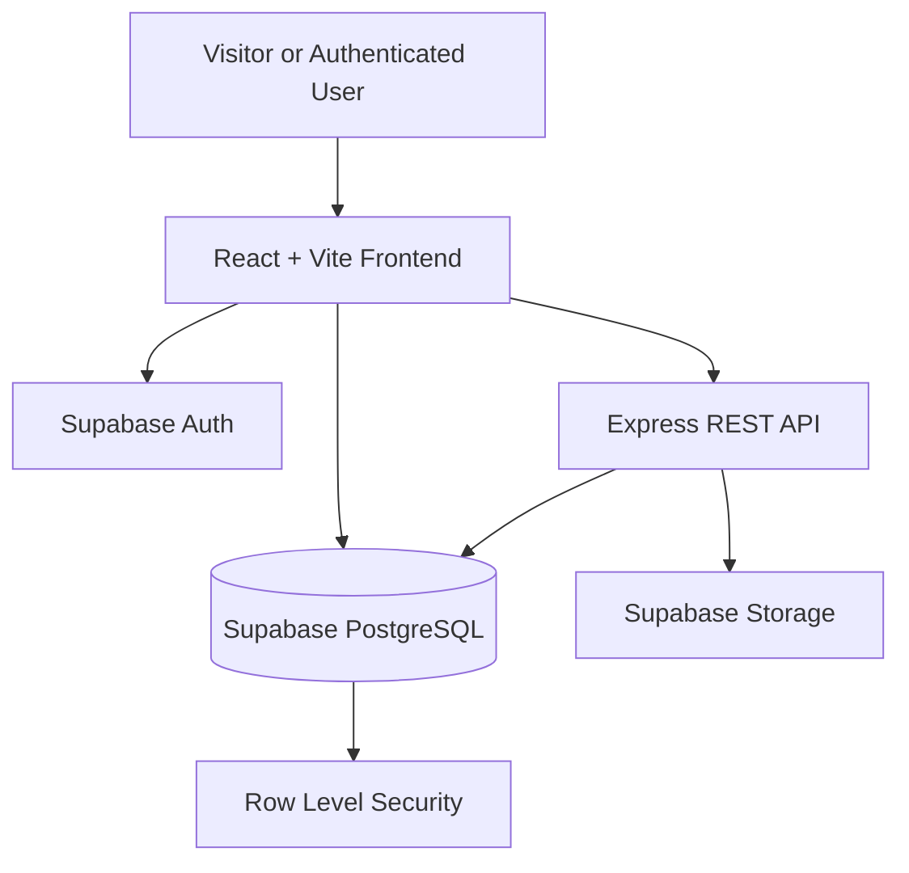

# SeeMenu - Discover Menus, Discover Places

**A community-driven restaurant menu discovery platform built for Bangladesh.**

SeeMenu helps people discover restaurants and explore their menus in one place. Instead of searching through scattered Facebook posts, Google Maps photos, and other sources to find what a restaurant serves, users can browse restaurant information and community-contributed menu images.

The platform combines restaurant discovery, user contributions, community feedback, and role-based content moderation in a full-stack web application.

<p align="center">
  <strong>Discover local food. Share menus. Help everyone choose better.</strong>
</p>

---

## Overview

Finding an accurate restaurant menu in Bangladesh can be unnecessarily difficult. Menu photos may be scattered across social media, prices may be outdated, and restaurant information may be incomplete or inconsistent.

SeeMenu aims to make this process easier through a centralized, community-driven platform where users can discover restaurants, view available menu information, and contribute useful updates.

The application is built as a full-stack project with a React frontend, an Express REST API, and Supabase for authentication, relational data storage, and image storage.

The project emphasizes:

- A straightforward and responsive user experience.
- Community participation and feedback.
- Role-based access control.
- Database-level security through Row Level Security (RLS).
- Moderation workflows for maintaining content quality.
- A maintainable separation between frontend, backend, and database responsibilities.

## Live Demo

- **Live website:** https://see-menu.vercel.app
- **GitHub repository:** https://github.com/shehedet/SeeMenu
- **Backend API:** https://seemenu-api.onrender.com

The frontend is hosted on Vercel, while the Express API is deployed separately.

> Some actions require an authenticated account with the appropriate permissions.

---

## Why SeeMenu?

Restaurant information is often available online, but finding a usable, current menu can require checking multiple sources. SeeMenu addresses this problem by bringing restaurant discovery and menu contributions into one application.

| Problem | SeeMenu's approach |
|---|---|
| Menus are scattered across different platforms. | Centralizes restaurant information and menu images. |
| Finding a particular restaurant or food category takes time. | Provides search and filtering on the homepage. |
| Restaurant information may be incomplete. | Supports community contributions and restaurant information updates. |
| User-submitted content needs oversight. | Provides moderation workflows and role-based permissions. |
| Public-facing applications need controlled access to sensitive actions. | Combines authenticated requests, backend authorization, and database RLS policies. |

---

## Features

### Restaurant Discovery

- Browse available restaurants from the homepage.
- Search restaurants using available restaurant information.
- Filter listings by restaurant name, description, location, and food types.
- View individual restaurant details.
- Explore restaurant location information and Google Maps links when provided.
- View restaurant cover images and relevant descriptive information.
- Load restaurant listings incrementally using the **See more** functionality.
- Receive a useful empty-results message when a search returns no matches.
- Use a responsive interface across desktop and mobile screen sizes.

### Restaurant Information Management

- Display restaurant names, descriptions, addresses, areas, cities, and food types.
- Provide Google Maps links where available.
- Display restaurant cover images.
- Allow authorized moderators and administrators to edit restaurant information.
- Support cover-image replacement.
- Allow authorized moderators and administrators to delete restaurants through the editing interface.

### Menu Image Contributions

- Store menu images in Supabase Storage.
- Associate uploaded images with restaurants.
- Track menu image metadata and moderation status in PostgreSQL.
- Support content visibility rules for approved and pending submissions.
- Restrict moderation actions to authorized roles.

### Community Interaction

The application includes database support for community features such as:

- Restaurant voting.
- Menu image voting.
- Comments.
- Content reports.
- Restaurant requests.
- Notifications.

Access to these features is governed by authentication and database policies.

### Authentication and Profiles

- User registration and login through Supabase Auth.
- Email verification as part of the registration flow.
- Logout functionality.
- User profiles associated with authenticated accounts.
- Role-aware access to protected functionality.
- Contributor, moderator, and administrator roles.

### Moderation

- Restrict sensitive restaurant and menu-management actions to authorized moderators and administrators.
- Apply database policies to protect records from unauthorized modifications.
- Support reporting and restaurant-request workflows.
- Apply access rules to menu image visibility and deletion.
- Protect image storage operations through server-side authorization and storage policies.

---

## User Roles and Permissions

SeeMenu uses role-based access control (RBAC) to distinguish ordinary contributions from moderation and administrative actions.

| Role | Responsibilities |
|---|---|
| **Visitor** | Browse publicly available restaurant information and approved menu content. |
| **Contributor** | Access contributor functionality, participate in community features, and submit eligible content or requests. |
| **Moderator** | Perform authorized moderation tasks, review reported content and requests, and manage restaurant or menu content. |
| **Admin** | Perform administrative actions, including higher-level role and access management where implemented. |

Permissions are enforced through a combination of frontend route protection, backend authorization checks, and Supabase Row Level Security policies. Hiding a button in the interface is not treated as sufficient authorization.

The exact actions available to a user depend on their role and the applicable database policies.

---

## Technology Stack

### Frontend

| Technology | Purpose |
|---|---|
| [React](https://react.dev/) | Component-based user interface |
| [Vite](https://vite.dev/) | Development server and production build tooling |
| [Tailwind CSS](https://tailwindcss.com/) | Utility-first styling |
| [React Router](https://reactrouter.com/) | Client-side routing |
| [Supabase JavaScript Client](https://supabase.com/docs/reference/javascript/introduction) | Authentication and authorized client-side database operations |

### Backend

| Technology | Purpose |
|---|---|
| [Node.js](https://nodejs.org/) | JavaScript runtime |
| [Express](https://expressjs.com/) | REST API and server-side request handling |
| [Supabase JavaScript Client](https://supabase.com/docs/reference/javascript/introduction) | Server-side access to Supabase services |
| [dotenv](https://github.com/motdotla/dotenv) | Environment variable loading |
| [CORS](https://github.com/expressjs/cors) | Cross-origin request configuration |
| [Nodemon](https://nodemon.io/) | Development-time server restarts |

### Database, Authentication, and Storage

| Technology | Purpose |
|---|---|
| [Supabase](https://supabase.com/) | Backend platform |
| [PostgreSQL](https://www.postgresql.org/) | Relational database |
| [Supabase Auth](https://supabase.com/docs/guides/auth) | User authentication |
| [Supabase Storage](https://supabase.com/docs/guides/storage) | Restaurant cover and menu image storage |
| Row Level Security (RLS) | Database-level access control |

### Deployment

- **Frontend:** Vercel
- **Backend:** Render
- **Database and authentication:** Supabase
- **Image storage:** Supabase Storage
- **Version control:** Git and GitHub

---

## System Architecture

SeeMenu separates the user interface, API logic, and data services into distinct components.



### How the Components Work Together

1. **Frontend:** React renders the interface, handles navigation, and manages user interactions.
2. **Authentication:** Supabase Auth manages user identity and sessions.
3. **REST API:** Express handles server-side operations that require backend validation and authorization.
4. **PostgreSQL:** Supabase stores restaurant information, user profiles, comments, votes, reports, requests, notifications, and menu metadata.
5. **Storage:** Supabase Storage stores restaurant covers and menu images.
6. **Security:** Backend authorization and RLS policies restrict access to protected operations and records.

The backend uses privileged Supabase credentials for server-side operations where necessary. Such credentials must never be exposed in frontend code.

---

## Database Design

SeeMenu uses PostgreSQL tables to represent its main entities and community workflows.

| Table | Purpose |
|---|---|
| `profiles` | User profile information and application roles |
| `restaurants` | Restaurant details, location information, and cover-image references |
| `menu_images` | Menu image metadata, restaurant associations, and moderation status |
| `comments` | User comments associated with application content |
| `restaurant_votes` | Community votes associated with restaurants |
| `menu_image_votes` | Community votes associated with menu images |
| `reports` | Reports submitted for review |
| `restaurant_requests` | Restaurant-related requests and their workflow status |
| `notifications` | User-specific notification records |

### Database Design Principles

- Use relational tables to represent entities and their relationships.
- Associate authenticated users with their profile records.
- Use foreign keys to maintain referential integrity.
- Apply appropriate delete behavior to related records.
- Use moderation status to control the visibility of submitted content.
- Apply RLS policies to control which records users can read or modify.
- Keep privileged database operations on the server.

### Image Storage

The application uses separate Supabase Storage buckets for different image types:

- `restaurant-covers` — restaurant cover images.
- `menu-images` — menu photographs.

The database stores image references and associated metadata, while the actual image files are stored in Supabase Storage.

---

## Authentication and Security

Security is an important part of SeeMenu because users have different permissions and some operations affect shared content.

### Authentication

Supabase Auth manages user authentication. User profiles are associated with authenticated user IDs, allowing application data and permissions to be linked to an account.

### Row Level Security

RLS policies are enabled on the application tables. Policies define which records users can read, insert, update, or delete based on factors such as:

- Whether the user is authenticated.
- Whether the user owns a record.
- Whether the related restaurant or menu image is approved.
- Whether the user's role permits a moderation action.

### Backend Authorization

Protected API operations validate the user's access token and verify the required role before performing privileged actions.

For example, restaurant deletion is handled by the backend, which checks moderator or administrator authorization before removing associated content and the restaurant record.

### Storage Security

Storage policies control access to image operations. Server-side code handles privileged cleanup operations when deleting restaurant or menu content.

### Environment Variables and Secrets

- Frontend environment variables use the `VITE_` prefix and are included in the client-side build. They must not contain secret credentials.
- The Supabase service-role key must remain on the backend.
- Never commit `.env` files or production secrets to GitHub.
- Production environment variables should be configured in the relevant hosting dashboards.

> Security policies should be tested independently of the interface. A hidden button or protected frontend route does not replace backend and database authorization.

---

## Project Structure

The repository separates the frontend and backend into two main directories.

```text
SeeMenu/
├── client/
│   ├── public/
│   │   └── favicon.png
│   ├── src/
│   │   ├── components/
│   │   ├── lib/
│   │   │   └── supabase.js
│   │   ├── pages/
│   │   └── ...
│   ├── index.html
│   ├── package.json
│   └── ...
├── server/
│   ├── src/
│   │   └── server.js
│   ├── package.json
│   └── ...
├── .gitignore
└── README.md
```

---